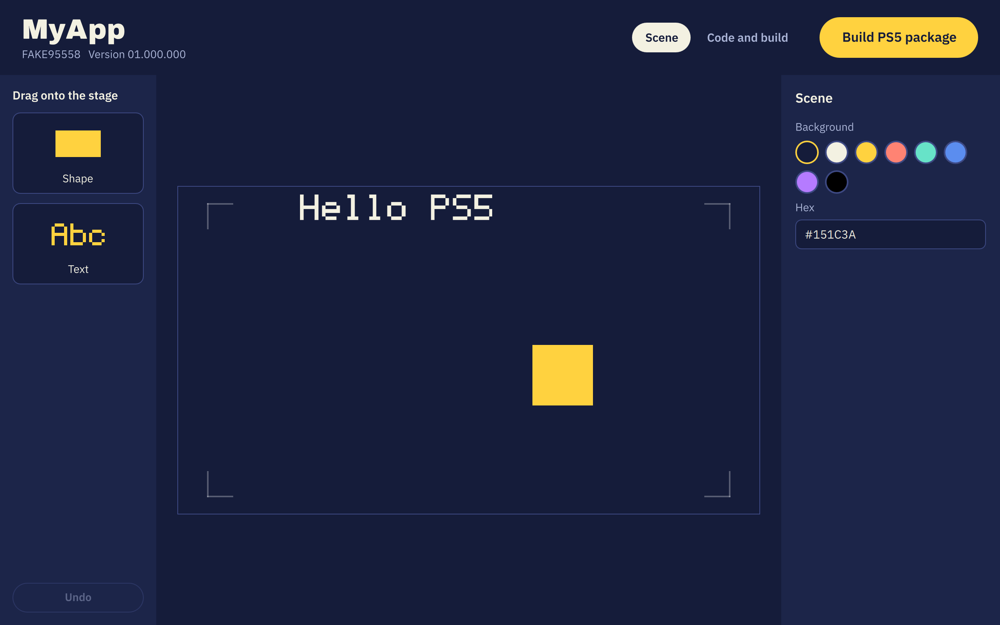

# AnyDevKit Studio

An open source desktop studio for making PS5 homebrew games and apps with
[AnyDevKit](https://github.com/boykopovar/AnyDevKit), on macOS, Windows and Linux.

AnyDevKit is a command line SDK. It compiles C++ and GLSL and packages the result for PS5.
Studio puts a visual workspace on top of it, so people can open a project, build it and
eventually create a whole game without living in a terminal.



> **Status: early development.** You can drag shapes and text onto a stage and build a PS5 package
> with one button. There is no download yet, so build it from source. The full flow has been tested
> on Apple Silicon macOS, and the app builds and starts on Windows and Linux in CI. The scene runtime
> compiles and packages for PS5 but has not yet been run on a console.

## What it does

| Stage | Goal | State |
|---|---|---|
| Project workspace | Open an `adk init` project and see its files and PS5 metadata | Working |
| One button build | Configure, compile and create a PS5 package with a live log | Working |
| Your code editor | Open code in VS Code, Visual Studio, Cursor, Xcode, CLion, Sublime Text, Zed or Qt Creator | Working |
| Drag and drop scene | Place shapes and text on a 16:9 stage, resize, undo, autosave | Working |
| Game runtime | Draws the scene on AGC, the PS5 graphics API, with controller movement | Compiles, not yet run on a console |
| Images and sound | Add your own pictures and audio to a scene | Planned |
| Behaviours | Ready-made actions, then game logic in Lua | Planned |
| Guided setup | Install AnyDevKit and its tools from inside Studio | Planned |
| Preview | Run the project on the developer's computer without a console | Planned |

## Build from source

You need CMake 3.22 or newer, a C++20 compiler and Qt 6.8 or newer with Qt Declarative.

```sh
cmake -S . -B build -DCMAKE_BUILD_TYPE=Release
cmake --build build
```

On macOS with Homebrew: `brew install cmake ninja qtbase qtdeclarative qtsvg`.

Studio also needs what AnyDevKit needs to build a project: the
[AnyDevKit SDK](https://github.com/boykopovar/AnyDevKit/releases/latest), its dependencies from
`adk setup`, Ninja, LLD and Clang 18+ or GCC 14+. Create a project with `adk init` and open its
folder in Studio.

### Apple Silicon

AnyDevKit does not publish macOS builds yet. Building it on a Mac currently needs the fixes in
[AnyDevKit #2](https://github.com/boykopovar/AnyDevKit/pull/2) and
[#3](https://github.com/boykopovar/AnyDevKit/pull/3). Use Homebrew LLVM (`brew install llvm lld`)
because Apple Clang is rejected by the C++ runtime's compiler check. Studio finds Homebrew's LLVM
on its own.

## How it is built

- **C++20** shares code with the engine runtime and fits the AnyDevKit toolchain.
- **Qt 6 and QML** give one GPU drawn interface that uses Metal on macOS, Direct3D on Windows and
  Vulkan on Linux.
- **A UI-free core library** holds projects and builds, and has its own tests.
- **`adk` stays a separate program.** Studio launches it rather than linking it, which keeps the
  two projects and their licenses independent. A crash in a build cannot take the editor down
  with it.

## Contributing

Fork it, build on it and send pull requests. See [CONTRIBUTING.md](CONTRIBUTING.md). Ideas and bug
reports are welcome in the issues.

## Legal

Licensed under the [MIT License](LICENSE). The bundled Archivo Black and IBM Plex fonts are under
the SIL Open Font License, included next to them in `src/app/assets/fonts`. AnyDevKit is a
separate project under GPL-2.0, and Studio only runs it as an external tool.

This is an independent project, not affiliated with or endorsed by Sony Interactive Entertainment.
PlayStation and PS5 are trademarks of their respective owner. Packages made with AnyDevKit are
homebrew and cannot be published on PlayStation Store.

## Credits

AnyDevKit Studio exists because of [AnyDevKit](https://github.com/boykopovar/AnyDevKit), created
by [boykopovar](https://github.com/boykopovar). Every PS5 package Studio builds is compiled and
packaged by AnyDevKit, which also relies on boykopovar's
[AnyPS5](https://github.com/boykopovar/AnyPS5) and
[llvm-cxx-ps](https://github.com/boykopovar/llvm-cxx-ps). Studio is an independent interface on
top of that work and is not an official boykopovar project.
